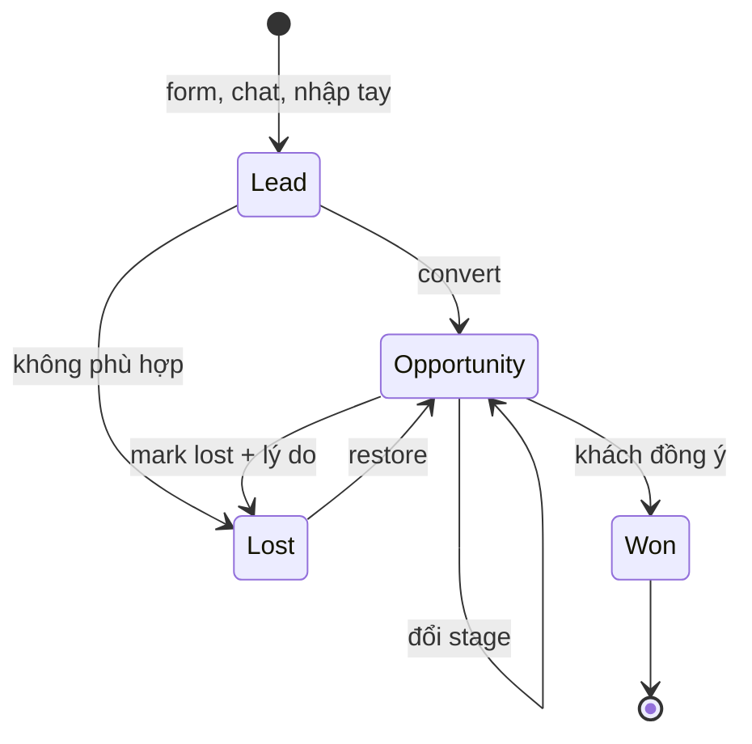
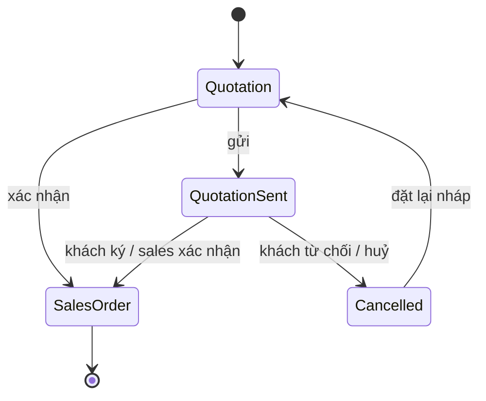
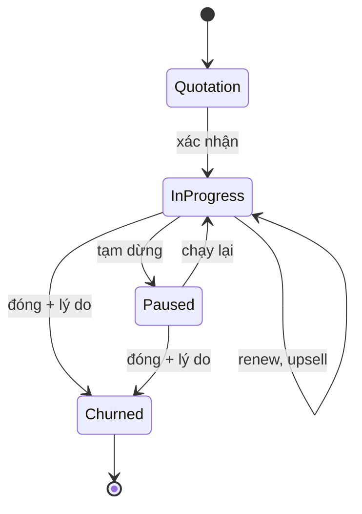
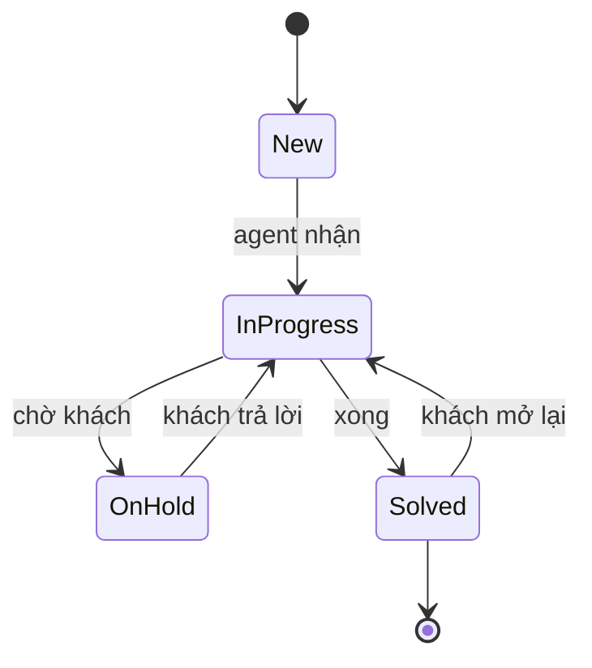
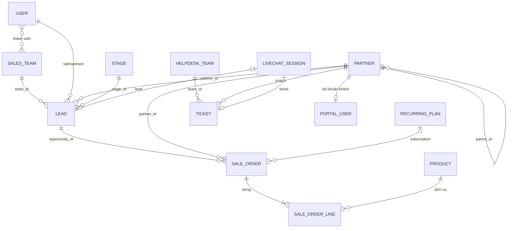

# Vision: CRM Platform

> Kim chỉ nam cho mọi quyết định scope. Khi phân vân "có nên làm X không?", đối chiếu với file này.
> Viết theo tiêu chí ở `02-workflow.md`, mục "Tiêu chí một spec tốt".

## Mục tiêu dự án

- **Thực hành nhiều tech stack** trên một domain thật, đưa vào CV với **vấn đề đã giải quyết + số liệu đo được**.
- **Nguyên tắc ưu tiên:** mục tiêu học > tính năng kinh doanh, nhưng mỗi tính năng phải có use case hợp lý với một agency.
- **Không tự nghĩ ra nghiệp vụ:** hệ thống làm theo mô hình của **Odoo 19.0** (CRM, Sales, Subscriptions, Helpdesk, Live Chat, Portal). Chi tiết model, field, trạng thái, quyền có nguồn ở [`reference/odoo.md`](reference/odoo.md). Làm khác Odoo thì ghi ở mục "Khác Odoo" kèm lý do.

## Bối cảnh business: Nova Agency

Công ty giả định, agency digital marketing ở TP.HCM, khoảng **50 người**.

**Dịch vụ** (thành sản phẩm loại Service, giá theo gói Basic / Standard / Premium, VND):

| Loại                      | Dịch vụ                                                                         | Cách tính tiền                                                      |
| ------------------------- | ------------------------------------------------------------------------------- | ------------------------------------------------------------------- |
| **Retainer** (hằng tháng) | Performance Ads management (Google, Meta, TikTok), SEO, Social Media management | Phí cố định mỗi tháng theo gói; hợp đồng thường 3–12 tháng, gia hạn |
| **One-off** (một lần)     | Website / Landing page, Branding, Marketing audit, Campaign setup               | Trọn gói một lần theo báo giá                                       |

Ngân sách chạy quảng cáo do khách tự trả cho nền tảng, Nova chỉ thu phí dịch vụ.

**Khách hàng:** chủ yếu là doanh nghiệp (chuỗi F&B, bán lẻ, giáo dục, bất động sản, startup công nghệ) cùng người liên hệ bên trong; có một ít khách cá nhân (KOL, chủ shop online).

**Cơ cấu:**

| Bộ phận                          | Người                                        | Việc                                                                   |
| -------------------------------- | -------------------------------------------- | ---------------------------------------------------------------------- |
| Ban giám đốc, vận hành           | CEO, Sales Director, Ops                     | Theo dõi toàn bộ khách và doanh thu, cấu hình hệ thống, quản lý user   |
| **Sales Team SME**               | Team leader + 4 sales                        | Khách nhỏ, chu trình ngắn, gói Basic/Standard                          |
| **Sales Team Key Accounts**      | Team leader + 3 key account manager          | Khách lớn, chu trình dài, gói Premium, nhiều dịch vụ cùng lúc          |
| **Helpdesk Team Client Support** | Support lead + 3 agent (kiêm trực live chat) | Nhận yêu cầu và sự cố từ khách đang chạy dịch vụ                       |
| Bộ phận triển khai               | Marketer, designer, SEO, developer           | Làm dịch vụ; **không dùng hệ thống này** (quản lý dự án ngoài phạm vi) |

## Vấn đề cần giải quyết

- Lead đến từ nhiều nơi (form web, chat, giới thiệu) bị bỏ sót, không rõ ai đang theo.
- Báo giá làm bằng file, khách xác nhận qua email; khó biết báo giá nào đang chờ, hết hạn.
- Hợp đồng retainer gia hạn bằng trí nhớ: quên nhắc, mất khách.
- Yêu cầu của khách nằm rải rác trong email, chat cá nhân; không đo được thời gian xử lý.
- Khách không tự xem được báo giá, hợp đồng, tiến độ yêu cầu của mình.

## Người dùng và quyền

Như Odoo, quyền **theo từng app**: mỗi user có một mức cho Sales, một mức cho Helpdesk, một mức cho Live Chat, cộng cờ quản trị hệ thống. Một user có thể thuộc nhiều Sales Team.

| Persona                          | Sales               | Helpdesk | Live Chat     | Hệ thống |
| -------------------------------- | ------------------- | -------- | ------------- | -------- |
| Sales (SME), Key account manager | User: Own Documents | User     |               |          |
| Sales team leader                | User: All Documents | User     |               |          |
| Sales Director                   | Administrator       | User     |               |          |
| Support agent                    | User: Own Documents | User     | Operator      |          |
| Support lead                     | User: Own Documents | Manager  | Administrator |          |
| CEO, Ops                         | Administrator       | Manager  | Administrator | Admin    |
| Khách hàng                       | Portal              | Portal   | Visitor       |          |

**Ma trận quyền** (theo record rules của Odoo, xem `reference/odoo.md` mục 1, 2, 3, 5, 7):

| Dữ liệu                              | Own Documents                                             | All Documents   | Administrator                 | Portal                                 |
| ------------------------------------ | --------------------------------------------------------- | --------------- | ----------------------------- | -------------------------------------- |
| Contact (công ty, người)             | Xem tất cả; tạo, sửa                                      | như Own         | + xoá, gộp                    | Công ty mình và người trong đó         |
| Lead, opportunity                    | Xem, sửa bản ghi mình là salesperson **hoặc chưa gán ai** | Xem, sửa tất cả | + xoá, cấu hình stage, team   | Không                                  |
| Quotation, sales order, subscription | như lead                                                  | như lead        | + xoá, cấu hình gói, template | Của công ty mình (đã gửi, đã xác nhận) |

| Dữ liệu              | Helpdesk User            | Helpdesk Manager            | Portal                             |
| -------------------- | ------------------------ | --------------------------- | ---------------------------------- |
| Ticket (team public) | Xem tất cả; sửa, trả lời | + cấu hình team, stage, SLA | Ticket mình theo dõi; tạo, trả lời |

Team **không** giới hạn ai thấy gì (giống Odoo): Sales Team dùng để chia lead, gom pipeline, chọn stage; quyền xem do mức quyền quyết định.

## Mô hình tham khảo: Odoo 19.0

| Khái niệm Nova                   | Odoo                                                            | Ghi chú                                                |
| -------------------------------- | --------------------------------------------------------------- | ------------------------------------------------------ |
| Contact (công ty hoặc người)     | `res.partner` (`is_company`, `parent_id`)                       | Một bảng; người trỏ công ty bằng `parent_id`           |
| Sales Team, thành viên           | `crm.team`, `crm.team.member`                                   | Một người nhiều team                                   |
| Lead, Opportunity                | `crm.lead` (`type`, `won_status`)                               | Một bảng; won / lost / pending                         |
| Stage, Lost reason, Tag          | `crm.stage`, `crm.lost.reason`, `crm.tag`                       | Stage chung hoặc theo team (`team_ids`)                |
| Activity, Chatter                | `mail.activity`, `mail.message`, `mail.followers`               | Việc cần làm có hạn; lịch sử, ghi chú trên mọi bản ghi |
| Dịch vụ, gói giá                 | `product.template` (type service), `product.pricelist`          |                                                        |
| Quotation, Sales Order           | `sale.order` (`draft`, `sent`, `sale`, `cancel`)                | Một bản ghi đi từ báo giá thành đơn                    |
| Quotation template               | `sale.order.template`                                           | Gói dịch vụ soạn sẵn                                   |
| Subscription (hợp đồng retainer) | `sale.order` có Recurring Plan (Enterprise)                     | In Progress, Paused, Churned; Renewal, Upsell          |
| Helpdesk Team, Ticket, SLA       | `helpdesk.team`, `helpdesk.ticket`, `helpdesk.sla` (Enterprise) |                                                        |
| Live chat channel, phiên chat    | `im_livechat.channel`, `discuss.channel` (livechat)             | Operator, chuyển thành lead / ticket                   |
| Tài khoản khách                  | `res.users` thuộc `base.group_portal`                           | Cấp từ contact                                         |

**Khác Odoo** (có lý do):

| Khác gì                                                                                                                  | Lý do                                                               |
| ------------------------------------------------------------------------------------------------------------------------ | ------------------------------------------------------------------- |
| Không hoá đơn, thanh toán; subscription chỉ có **ngày kỳ tiếp theo** để nhắc; đóng subscription không cần đã lập hoá đơn | Ngoài phạm vi (kế toán làm ở phần mềm khác)                         |
| Một công ty (không multi-company), một tiền tệ VND, giá chưa thuế                                                        | Nova là một pháp nhân; thuế thuộc kế toán                           |
| Mỗi app là một module, một schema riêng, tham chiếu chéo bằng id (ADR-0001)                                              | Mục tiêu học: modular monolith; Odoo dùng chung một database và ORM |
| Live chat chưa có chatbot                                                                                                | Để dành cho AI service (Python)                                     |

## Quy trình end-to-end

### A. Lead → Opportunity

| Bước | Ai                       | Làm gì                                                                                       | Trạng thái sau bước        |
| ---- | ------------------------ | -------------------------------------------------------------------------------------------- | -------------------------- |
| 1    | Khách / sales / operator | Lead vào: form website, `/lead` trong live chat, sales nhập tay                              | Lead, chưa gán             |
| 2    | Hệ thống / team leader   | Chia lead: theo quy mô công ty về Sales Team SME hoặc Key Accounts, rồi xoay vòng trong team | Lead, có team, salesperson |
| 3    | Sales                    | Gọi, ghi activity, chatter; lead không phù hợp thì Lost kèm lý do                            | Lead                       |
| 4    | Sales                    | Convert: tạo mới hoặc chọn contact công ty + người                                           | Opportunity, stage New     |
| 5    | Sales                    | Kéo qua stage New → Qualified → Proposition; cập nhật doanh thu dự kiến, ngày chốt           | Opportunity                |
| 6    | Sales                    | Khách đồng ý → Won; từ chối → Lost + lý do                                                   | Won / Lost                 |

### B. Quotation → Sales Order

| Bước | Ai       | Làm gì                                                                    | Trạng thái              |
| ---- | -------- | ------------------------------------------------------------------------- | ----------------------- |
| 1    | Sales    | Tạo quotation từ opportunity, chọn template (gói), sửa dòng, hạn hiệu lực | Quotation               |
| 2    | Sales    | Gửi: khách nhận email có link portal                                      | Quotation Sent          |
| 3    | Khách    | Mở trên portal, ký online, hoặc từ chối kèm lời nhắn                      | Sales Order / Cancelled |
| 4    | Sales    | Hoặc xác nhận tay khi khách đồng ý ngoài hệ thống                         | Sales Order             |
| 5    | Hệ thống | Nâng doanh thu dự kiến của opportunity; sales đánh Won                    |                         |

### C. Subscription (retainer)

| Bước | Ai            | Làm gì                                                                       | Trạng thái                               |
| ---- | ------------- | ---------------------------------------------------------------------------- | ---------------------------------------- |
| 1    | Sales         | Quotation có Recurring Plan (hằng tháng), xác nhận như B                     | In Progress                              |
| 2    | Hệ thống      | Trước ngày kỳ tiếp theo, ngày hết hạn: nhắc salesperson, gửi email khách     | In Progress                              |
| 3    | Sales         | **Renew**: tạo Renewal Quotation; **Upsell**: thêm dịch vụ, giá chia theo kỳ | Renewal / Upsell quotation → In Progress |
| 4    | Sales         | Tạm dừng khi khách hoãn                                                      | Paused                                   |
| 5    | Sales / khách | Đóng kèm lý do và ngày đóng (khách đóng trên portal nếu plan cho phép)       | Churned                                  |

### D. Support ticket

| Bước | Ai               | Làm gì                                                                       | Trạng thái  |
| ---- | ---------------- | ---------------------------------------------------------------------------- | ----------- |
| 1    | Khách / operator | Gửi email support@, tạo trên portal, hoặc operator dùng `/ticket` trong chat | New         |
| 2    | Hệ thống         | Gán agent theo tải; áp SLA theo priority (hạn đạt một stage)                 | New, có SLA |
| 3    | Agent            | Trả lời qua chatter (khách nhận email, thấy trên portal), đổi stage          | In Progress |
| 4    | Hệ thống         | Sắp trễ hoặc trễ SLA: báo agent, support lead                                |             |
| 5    | Agent / khách    | Xong thì Solved, khách đánh giá; cần bán thêm thì convert thành opportunity  | Solved      |

### E. Live chat

Khách vào website Nova → widget chat → hệ thống chọn operator đang online, ít phiên nhất → hội thoại → operator dùng `/lead` (thành lead, kèm transcript) hoặc `/ticket` (thành ticket) → khách đánh giá phiên chat.

### F. Portal

Ops cấp quyền portal từ một contact (cấp cho công ty thì mọi người trong công ty có quyền) → khách đăng nhập: xem, ký, từ chối báo giá; xem đơn hàng; xem subscription, đóng nếu plan cho phép; tạo, theo dõi, trả lời ticket; sửa thông tin của mình. Link báo giá trong email mở được không cần tài khoản (token).

### Một ngày ở Nova

Chị Hana (marketing director chuỗi Greenleaf Coffee) để lại form trên website. Lead vào Sales Team Key Accounts vì Greenleaf có 30 cửa hàng, xoay vòng tới Linh. Linh gọi, convert thành opportunity, tạo contact công ty Greenleaf và người Hana. Sau buổi discovery, Linh gửi báo giá gói Performance Ads Premium + Social Media Standard theo template, hằng tháng. Hana ký trên portal: báo giá thành subscription In Progress, opportunity Won. Ba tháng sau, Hana nhắn trên live chat báo quảng cáo bị từ chối; agent An tạo ticket bằng `/ticket`, SLA 8 giờ làm việc, xử lý xong Hana đánh giá 5 sao. Trước kỳ gia hạn hai tuần, hệ thống nhắc Linh tạo Renewal Quotation.

## Mô hình nghiệp vụ

Activity và chatter gắn được vào mọi bản ghi (lead, contact, sales order, ticket) bằng `(model, id)`.

## Phạm vi hệ thống

| App               | Có gì                                                                                                    |
| ----------------- | -------------------------------------------------------------------------------------------------------- |
| **Contacts**      | Công ty, người, địa chỉ, tag; tìm, lọc; lưu trữ                                                          |
| **CRM**           | Sales Team, lead, opportunity, pipeline Kanban, stage, lost reason, chia lead tự động, activity, chatter |
| **Sales**         | Dịch vụ, gói giá, quotation template, quotation, gửi email, ký trên portal, sales order                  |
| **Subscriptions** | Recurring plan, subscription, nhắc gia hạn, renew, upsell, pause, close                                  |
| **Helpdesk**      | Helpdesk team, ticket, stage, SLA, gán theo tải, ticket từ email, portal, chat                           |
| **Live Chat**     | Widget website, operator, chuyển thành lead / ticket, đánh giá                                           |
| **Portal**        | Tài khoản khách, báo giá, đơn, subscription, ticket                                                      |
| **Settings**      | User, quyền theo app, Sales Team, Helpdesk Team                                                          |

**Ngoài phạm vi** (không làm, trừ khi vision đổi):

- Hoá đơn, thanh toán online, kế toán, thuế (làm ở phần mềm kế toán)
- Quản lý dự án, task, timesheet của bộ phận triển khai
- Báo cáo, dashboard, analytics (MRR, pipeline)
- Email marketing, landing page, tracking quảng cáo
- Kênh chat ngoài website (Zalo OA, Messenger), đồng bộ Gmail / Calendar
- Multi-company, nhiều tiền tệ, eCommerce, kho
- Mobile app

## Thuật ngữ

| Thuật ngữ       | Nghĩa                                            | Odoo                            |
| --------------- | ------------------------------------------------ | ------------------------------- |
| Contact         | Công ty hoặc người bên khách                     | `res.partner`                   |
| Salesperson     | Nhân viên phụ trách một bản ghi                  | `user_id`                       |
| Sales Team      | Nhóm sales, có pipeline và quy tắc chia lead     | `crm.team`                      |
| Lead            | Yêu cầu chưa xác minh                            | `crm.lead` `type = lead`        |
| Opportunity     | Cơ hội bán hàng trên pipeline                    | `crm.lead` `type = opportunity` |
| Pipeline, Stage | Các bước của opportunity                         | `crm.stage`                     |
| Activity        | Việc cần làm có hạn (gọi, gặp, email, việc khác) | `mail.activity`                 |
| Chatter         | Lịch sử thay đổi, ghi chú, tin nhắn trên bản ghi | `mail.thread`                   |
| Quotation       | Báo giá chưa xác nhận                            | `sale.order` `draft`, `sent`    |
| Sales Order     | Báo giá đã xác nhận                              | `sale.order` `sale`             |
| Subscription    | Sales order định kỳ (retainer)                   | `sale.order` + Recurring Plan   |
| Recurring Plan  | Chu kỳ tính phí (hằng tháng, hằng năm)           | Recurring Plan                  |
| Ticket          | Yêu cầu hỗ trợ của khách                         | `helpdesk.ticket`               |
| SLA             | Hạn xử lý ticket theo priority                   | `helpdesk.sla`                  |
| Portal          | Trang khách hàng tự đăng nhập                    | `/my`, `base.group_portal`      |

## Kỹ thuật

| Stack                                                   | Dùng cho nghiệp vụ                                                                                        |
| ------------------------------------------------------- | --------------------------------------------------------------------------------------------------------- |
| NestJS, PostgreSQL, React, TanStack                     | Lõi: mọi app ở trên, modular monolith (ADR-0001)                                                          |
| **Keycloak** (OIDC)                                     | Đăng nhập nhân viên và tài khoản portal của khách (realm riêng), quyền theo app                           |
| **Redpanda** + service notifications (NestJS app riêng) | Event backbone (outbox) + Notification service: email báo giá, nhắc gia hạn, thông báo ticket và activity |
| **Temporal**                                            | Việc theo thời gian: hết hạn báo giá, nhắc gia hạn subscription, SLA ticket                               |
| **Python**                                              | AI service: tóm tắt chatter, ticket; gợi ý trả lời chat; chấm điểm lead                                   |
| Docker Compose                                          | Môi trường local; deploy demo ở Phase 4                                                                   |

Phase nào đưa stack nào vào: `01-roadmap.md`.

## Mục tiêu thời gian

| Mốc                 | Thời hạn                          | Kết quả                          |
| ------------------- | --------------------------------- | -------------------------------- |
| Phase 0 + Phase 1   | Không deadline cứng (xem roadmap) | CRM dùng được, có seed data Nova |
| Link demo công khai | Phase 4, sau Helpdesk + Portal    |                                  |
| Các phase sau       | Lên kế hoạch khi phase trước xong |                                  |

## Ngoài phạm vi kỹ thuật

- Microservices cho phần lõi (chỉ tách khi có lý do, ADR-0001)
- Kubernetes, IaC, service mesh
