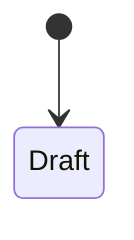

# Phase N: <Tên> · Spec

> Theo tiêu chí ở `docs/02-workflow.md`, mục "Tiêu chí một spec tốt".

## Mục tiêu

Phase này giải quyết vấn đề gì? (1–3 câu). Làm phần nào của vision (`docs/00-vision.md`, mục ...).

## Người dùng và quy trình

Role nào dùng tính năng của phase. Quy trình nào của vision được làm, tới bước nào.

| Bước | Ai  | Làm gì | Trạng thái sau bước |
| ---- | --- | ------ | ------------------- |
| 1    |     |        |                     |

## Yêu cầu chức năng

- **XXX-01** Là <role>, tôi <làm gì> để <mục đích>.
  - Quy tắc nghiệp vụ, điều kiện, lỗi.

## Mô hình dữ liệu

Entity của phase, trường chính, quan hệ, tương ứng trong Odoo.

| Entity | Odoo | Trường chính | Ghi chú |
| ------ | ---- | ------------ | ------- |
|        |      |              |         |

## Phân quyền

| Hành động | Role A | Role B | Role C |
| --------- | ------ | ------ | ------ |
|           |        |        |        |

## Yêu cầu phi chức năng

Chỉ ghi khi có (hiệu năng, bảo mật, audit, khả dụng).

## Ngoài phạm vi

- <Việc> → <phase sau / backlog / không làm>

## Tiêu chí hoàn thành (Definition of Done)

- [ ]

## Số liệu cần đo

Không bắt buộc. Bỏ mục này nếu phase không đo gì.

| Chỉ số | Cách đo | Mục tiêu |
| ------ | ------- | -------- |
|        |         |          |

## Giả định, phụ thuộc, rủi ro, câu hỏi mở

-

## Quyết định đã chốt

| #   | Câu hỏi | Quyết định | Lý do |
| --- | ------- | ---------- | ----- |
|     |         |            |       |
