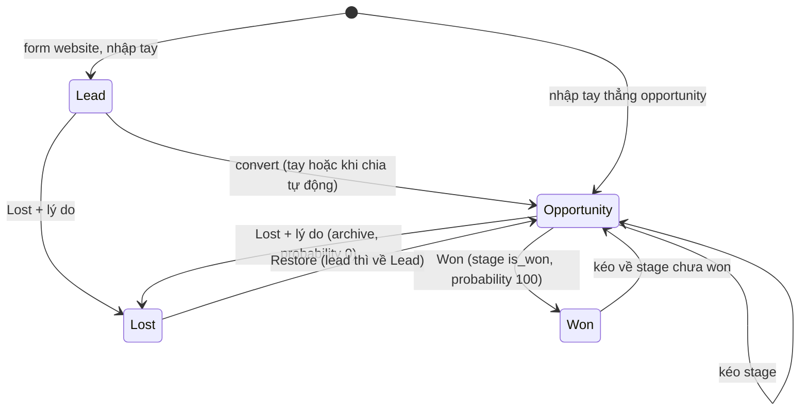

# Phase 1: CRM · Spec

> Theo tiêu chí ở `docs/02-workflow.md`, mục "Tiêu chí một spec tốt". Viết lại ngày 2026-11-09 theo mô hình Odoo 19.0; bản cũ (Contacts/Companies/Deals, phân quyền theo team) xem lịch sử git.

## Mục tiêu

Sales của Nova không bỏ sót lead nào: lead vào từ form website hoặc nhập tay, tự chia về đúng Sales Team và salesperson, đi qua pipeline tới Won/Lost, mọi việc cần làm và lịch sử nằm trên bản ghi. Làm app **Contacts**, **CRM** và phần Sales Team, user của **Settings** trong vision (`00-vision.md`, mục "Phạm vi hệ thống"), quy trình **A. Lead → Opportunity**.

Về kỹ thuật: mỗi app một module, một schema (ADR-0001), nên đây là phase kiểm chứng cách ghép dữ liệu giữa các module không join chéo schema.

## Người dùng và quy trình

Role dùng trong phase: Sales User (Own Documents, All Documents), Sales Administrator, quản trị hệ thống, khách vãng lai (gửi form website). Chưa có Helpdesk, Live Chat, Portal.

Quy trình A của vision, làm đủ 6 bước; lead từ live chat (`/lead`) để Phase 3.

| Bước | Ai            | Làm gì                                                                                       | Trạng thái sau bước                 | Yêu cầu            |
| ---- | ------------- | -------------------------------------------------------------------------------------------- | ----------------------------------- | ------------------ |
| 1    | Khách / sales | Gửi form "Contact us" trên website, hoặc sales nhập tay                                      | Lead, chưa gán                      | CRM-01, CRM-11     |
| 2    | Hệ thống      | Chia lead theo rule của Sales Team, xoay vòng trong team theo capacity; gán xong thì convert | Opportunity, có team và salesperson | CRM-12, CRM-13     |
| 2'   | Team leader   | Lead không khớp rule: gán tay                                                                | Lead, có salesperson                | CRM-03             |
| 3    | Sales         | Gọi, lên lịch activity, ghi note; lead không phù hợp thì Lost kèm lý do                      | Lead                                | ACT-01..05, CRM-07 |
| 4    | Sales         | Convert: tạo contact mới (công ty + người) hoặc chọn contact có sẵn                          | Opportunity, stage đầu của team     | CRM-04             |
| 5    | Sales         | Kéo qua New → Qualified → Proposition; cập nhật doanh thu dự kiến, ngày chốt, xác suất       | Opportunity                         | CRM-05, CRM-06     |
| 6    | Sales         | Khách đồng ý → Won; từ chối → Lost + lý do; mở lại bằng Restore                              | Won / Lost                          | CRM-07, CRM-08     |

Trạng thái theo `won_status` của Odoo 19.0 (`reference/odoo.md`, mục 3):

Lead và Opportunity là `pending`. Archive / unarchive (không phải Lost) ẩn, hiện bản ghi mà không đổi trạng thái.

## Yêu cầu chức năng

Đã xong ở slice 1.1–1.3 (giữ mã để truy vết):

- **AUTH-01** Là nhân viên, tôi đăng nhập bằng email và mật khẩu, phiên tự gia hạn, đăng xuất được. _(1.2)_
- **AUTH-02** Là nhân viên, tôi đổi mật khẩu của mình. _(1.2)_

### Settings: user, quyền, Sales Team

- **SET-01** Là quản trị hệ thống, tôi tạo, sửa, archive user nhân viên để cấp và thu quyền vào hệ thống.
  - Trường: tên, email (duy nhất), mật khẩu ban đầu, mức quyền Sales, cờ quản trị hệ thống.
  - User bị archive không đăng nhập được, phiên đang có hết hiệu lực ở lần refresh kế tiếp; vẫn hiện tên trên bản ghi cũ.
  - Không tự archive chính mình, không bỏ cờ quản trị của quản trị viên cuối cùng.
- **SET-02** Là quản trị hệ thống, tôi đặt mức quyền Sales cho user: không có, **User: Own Documents**, **User: All Documents**, **Administrator** (`sales_team.group_sale_*`).
  - Thay cho role `admin` / `manager` / `member` và scope theo team của ADR-0005.
- **SET-03** Là Sales Administrator, tôi tạo, sửa, archive Sales Team: tên, team leader, thành viên.
  - Một user thuộc được nhiều team (Odoo bật "Multi Teams").
  - Mỗi thành viên có capacity (số lead tối đa nhận trong 30 ngày, mặc định 30) và cờ tạm dừng nhận lead.
- **SET-04** Là Sales User, tôi xem danh sách Sales Team và thành viên (chỉ đọc).

### Contacts

- **CON-01** Là nhân viên, tôi tạo contact là **công ty** hoặc **người**; người có thể thuộc một công ty (`parent_id`).
  - Trường chính: tên, loại, công ty cha, email, phone, website, chức danh, địa chỉ, MST, ngành, tag, salesperson, ghi chú.
  - Công ty cha phải là contact loại công ty, không tạo vòng.
- **CON-02** Là nhân viên, tôi xem danh sách contact (tìm theo tên, email, phone; lọc loại, tag, salesperson, công ty; sắp xếp; phân trang) và chi tiết contact.
  - Chi tiết công ty liệt kê người thuộc công ty và opportunity của công ty.
  - Mọi nhân viên thấy mọi contact, như Odoo (team không giới hạn).
- **CON-03** Là nhân viên, tôi sửa và archive / restore contact. Contact đã archive không hiện trong danh sách mặc định và không chọn được ở form khác, bản ghi đang trỏ tới vẫn hiện tên kèm nhãn Archived.
- **CON-04** Là nhân viên, tôi quản lý tag contact (tạo khi gõ trong form).

### CRM

- **CRM-01** Là sales, tôi tạo lead hoặc opportunity bằng tay.
  - Trường: tiêu đề, contact (hoặc tên công ty, tên người, email, phone khi chưa có contact), salesperson, Sales Team, doanh thu dự kiến (VND), xác suất, ngày chốt dự kiến, priority (0–3), tag, nguồn, mô tả.
  - Salesperson mặc định là người tạo; team tự lấy theo salesperson (team đầu tiên user là thành viên), đổi salesperson thì đổi team nếu user mới không thuộc team hiện tại.
- **CRM-02** Là sales, tôi xem lead (danh sách) và opportunity (Kanban theo stage, danh sách), lọc theo salesperson, team, tag, stage, Won/Lost/Pending, "của tôi", "chưa gán".
  - **Own Documents** thấy bản ghi mình là salesperson hoặc chưa gán ai; **All Documents** trở lên thấy tất cả. Không thấy → 404.
- **CRM-03** Là sales, tôi sửa lead/opportunity mình thấy, gán salesperson khác.
- **CRM-04** Là sales, tôi convert lead thành opportunity: chọn contact có sẵn, hoặc tạo mới (công ty từ "tên công ty", người con từ "tên người"); có thể đổi salesperson, team.
  - Opportunity vào stage đầu của team. Lead đã Won/Lost không convert được.
  - Có contact trùng email: gợi ý chọn contact đó.
- **CRM-05** Là sales, tôi kéo opportunity giữa các stage trên Kanban; thứ tự trong cột giữ được.
  - Stage chung hoặc riêng theo team (`team_ids`); Kanban của một team chỉ hiện stage của team đó.
- **CRM-06** Là sales, tôi đánh **Won**: bản ghi chuyển sang stage won, xác suất 100.
- **CRM-07** Là sales, tôi đánh **Lost** kèm lost reason (bắt buộc) và ghi chú: bản ghi bị archive, xác suất 0.
- **CRM-08** Là sales, tôi **Restore** bản ghi Lost, hoặc archive / unarchive mà không phải Lost.
- **CRM-09** Là Sales Administrator, tôi xoá lead/opportunity.
- **CRM-10** Là sales, tôi tạo tag CRM khi gõ trong form.
- **CRM-11** Là khách vãng lai, tôi gửi form "Contact us" trên website (tên, công ty, email, phone, quy mô công ty, dịch vụ quan tâm, lời nhắn) để Nova liên hệ.
  - Endpoint công khai tạo lead chưa gán, nguồn Website. Chống spam: giới hạn số lần gửi theo IP, trường honeypot.
  - Có trang form demo (thay cho website thật của Nova).
- **CRM-12** Là Sales Administrator, tôi đặt rule chia lead cho từng Sales Team: điều kiện đơn giản trên field của lead (quy mô công ty, nguồn, tag...), tạm dừng chia cho cả team.
- **CRM-13** Là hệ thống, khi có lead chưa gán, tôi chia ngay:
  - Chọn team đầu tiên (theo thứ tự) có rule khớp; không team nào khớp thì để chưa gán.
  - Trong team, xoay vòng cho thành viên đang nhận lead, còn capacity, ít lead nhất trong 24 giờ.
  - Gán xong thì convert thành opportunity (như Odoo). Ghi vào chatter ai được gán, theo rule nào.
- **CRM-14** Là Sales Administrator, tôi chạy lại việc chia cho các lead đang chưa gán (nút "Assign leads").

### Activity và chatter

- **ACT-01** Là nhân viên, tôi lên lịch activity trên contact hoặc lead/opportunity: loại (Call, Meeting, Email, To-Do), tóm tắt, ghi chú, hạn, người được giao (mặc định là mình).
- **ACT-02** Là nhân viên, tôi đánh activity là xong kèm phản hồi: activity rời danh sách đang chờ, chatter ghi lại; hoặc huỷ activity.
- **ACT-03** Là nhân viên, tôi xem danh sách activity của tôi (quá hạn, hôm nay, sắp tới); Kanban opportunity hiện trạng thái activity gần nhất.
- **ACT-04** Là nhân viên, tôi ghi note nội bộ trên chatter của contact, lead/opportunity.
- **ACT-05** Là nhân viên, tôi xem chatter: note, activity đã xong, thay đổi tự ghi (stage, salesperson, team, Won/Lost, doanh thu dự kiến, tạo, convert), mới nhất trước.
- Quyền: xem activity và chatter theo quyền xem bản ghi đích; sửa, xoá activity khi mình là người được giao hoặc người tạo.

## Mô hình dữ liệu

| Entity             | Odoo                      | Module     | Trường chính                                                                                                                                                                                                                                                | Ghi chú                                                                    |
| ------------------ | ------------------------- | ---------- | ----------------------------------------------------------------------------------------------------------------------------------------------------------------------------------------------------------------------------------------------------------- | -------------------------------------------------------------------------- |
| User               | `res.users`               | identity   | name, email, password_hash, sales_access (`none`/`own`/`all`/`admin`), is_system_admin, archived_at                                                                                                                                                         | Bỏ `role`, `team_id`                                                       |
| Sales Team         | `crm.team`                | chốt ở 1.5 | name, leader_id, sequence, assignment_rule, assignment_paused, archived_at                                                                                                                                                                                  | `assignment_rule` thay `assignment_domain` (xem Khác Odoo)                 |
| Sales Team member  | `crm.team.member`         | chốt ở 1.5 | team_id, user_id, capacity (30), assignment_paused                                                                                                                                                                                                          | Một user nhiều team                                                        |
| Contact            | `res.partner`             | contacts   | name, is_company, parent_id, email, phone, website, job_title, address (street, city, country), tax_id, industry, tags, salesperson_id, note, archived_at                                                                                                   | Một bảng cho công ty và người; bỏ `owner_id`, `team_id` của 1.3            |
| Contact tag        | `res.partner.category`    | contacts   | name, color                                                                                                                                                                                                                                                 |                                                                            |
| Lead / Opportunity | `crm.lead`                | crm        | type, name, contact_id, partner_name, contact_name, email, phone, salesperson_id, team_id, stage_id, expected_revenue, probability, date_deadline, priority, tags, source, lost_reason_id, lost_note, won_status, archived_at, date_conversion, date_closed | `won_status` tính như Odoo, lưu để lọc                                     |
| Stage              | `crm.stage`               | crm        | name, sequence, is_won, fold, team_ids                                                                                                                                                                                                                      | Mặc định New, Qualified, Proposition, Won; chỉ tạo bằng seed trong Phase 1 |
| Lost reason        | `crm.lost.reason`         | crm        | name, archived_at                                                                                                                                                                                                                                           | Seed: Too expensive, No budget, Chose competitor, Not a fit, No response   |
| CRM tag            | `crm.tag`                 | crm        | name, color                                                                                                                                                                                                                                                 |                                                                            |
| Activity           | `mail.activity`           | chốt ở 1.7 | res_model, res_id, type, summary, note, due_date, assignee_id, done_at, feedback, created_by                                                                                                                                                                | Polymorphic `(res_model, res_id)`, không FK                                |
| Activity type      | `mail.activity.type`      | chốt ở 1.7 | name, icon, default_delay_days                                                                                                                                                                                                                              | Seed: Call, Meeting, Email, To-Do                                          |
| Message (chatter)  | `mail.message` + tracking | chốt ở 1.7 | res_model, res_id, kind (`note`/`activity_done`/`tracking`/`system`), body, author_id, tracking (field, old, new), created_at                                                                                                                               | Không có email, follower ở phase này                                       |

Tham chiếu chéo module bằng id, không FK; dữ liệu module khác lấy bằng public service theo lô (ADR-0001, ADR chốt ở slice 1.6).

## Phân quyền

Theo record rule của Odoo (`reference/odoo.md`, mục 1–4). Team không giới hạn ai thấy gì.

| Hành động                                  | Own Documents               | All Documents | Sales Administrator | Quản trị hệ thống (không có quyền Sales) |
| ------------------------------------------ | --------------------------- | ------------- | ------------------- | ---------------------------------------- |
| Xem, tạo, sửa, archive contact             | ✓                           | ✓             | ✓                   | ✓                                        |
| Xem, sửa lead/opportunity                  | Của mình hoặc chưa gán      | Tất cả        | Tất cả              | Không                                    |
| Tạo lead/opportunity, Won, Lost, Restore   | Như sửa                     | Như sửa       | Như sửa             | Không                                    |
| Xoá lead/opportunity                       | Không                       | Không         | ✓                   | Không                                    |
| Xem Sales Team                             | ✓                           | ✓             | ✓                   | ✓                                        |
| Sửa Sales Team, thành viên, rule chia lead | Không                       | Không         | ✓                   | Không                                    |
| Chạy "Assign leads"                        | Không                       | Không         | ✓                   | Không                                    |
| Quản lý user, mức quyền                    | Không                       | Không         | Không               | ✓                                        |
| Activity, chatter                          | Theo quyền xem bản ghi đích | như trái      | như trái            | Theo quyền xem bản ghi đích              |

Không thấy (id lạ, ngoài quyền xem) → 404; thấy mà không được làm → 403. DTO có `permissions` cho các hành động giao diện cần ẩn/hiện.

## Yêu cầu phi chức năng

- **Ranh giới module:** không module nào join hay import ruột module khác (lint ranh giới xanh); danh sách có dữ liệu module khác gọi theo lô một lần cho cả trang.
- **Form công khai:** giới hạn tần suất theo IP, không lộ thông tin nội bộ trong lỗi, có test.
- **Audit:** mọi thay đổi field quan trọng của lead/opportunity có trong chatter (ACT-05).

## Khác Odoo (trong phase)

| Khác gì                                                                                 | Lý do                                                                   |
| --------------------------------------------------------------------------------------- | ----------------------------------------------------------------------- |
| Chia lead chạy ngay khi lead vào (và nút "Assign leads"), không có cron "Repeatedly"    | Nova ít lead, cần phản hồi nhanh; cron định kỳ cân nhắc khi có Temporal |
| Rule chia lead là điều kiện đơn giản (field = giá trị), không phải domain tuỳ ý         | Đủ cho Nova, tránh viết bộ dịch domain                                  |
| Không gộp lead trùng, không xác suất tự động (Predictive Lead Scoring), không "rotting" | Ngoài phạm vi phase, xem dưới                                           |
| Field "quy mô công ty" trên lead (từ form website)                                      | Odoo không có sẵn; Nova dùng để chia SME / Key Accounts                 |

## Ngoài phạm vi

- Gộp lead / contact trùng, xoá cứng contact → backlog
- Cấu hình stage, lost reason, activity type trên giao diện (chỉ seed) → backlog
- Custom fields (Studio) → backlog
- Lead scoring, chatbot → Phase 5 (AI)
- Email trong chatter ("Send message"), followers, notification → Phase 2 (service notifications)
- Doanh thu định kỳ trên opportunity (Recurring Plan, MRR) → Phase 2 (Subscriptions)
- Lead từ live chat, email alias → Phase 3
- Báo cáo pipeline, dashboard → không làm (vision)
- Đăng nhập OIDC → Phase 3 (Keycloak); deploy, link demo → Phase 4
- Import/export → backlog

## Tiêu chí hoàn thành (Definition of Done)

- [ ] `make up` + `make seed` → đăng nhập bằng user seed của từng mức quyền, đi hết quy trình A: form website → lead tự gán → opportunity → kéo stage → Won / Lost
- [ ] Test e2e: Own Documents không thấy (404), không sửa được opportunity của người khác; thấy lead chưa gán; All Documents thấy tất cả
- [ ] Test e2e: chia lead theo rule và xoay vòng, tôn trọng capacity và tạm dừng
- [ ] Mọi nhân viên thấy mọi contact; công ty hiện người và opportunity của nó
- [ ] Chatter của lead hiện thay đổi stage, salesperson, Won/Lost; activity xong hiện trong chatter
- [ ] Không module nào join hay import ruột module khác (lint ranh giới xanh)
- [ ] ADR: quyền theo app (thay ADR-0005), tham chiếu chéo module
- [ ] CI xanh, `make lint typecheck test build` pass; smoke test có đủ màn hình mới

## Giả định, phụ thuộc, rủi ro, câu hỏi mở

- **Refactor Contacts (1.3 → 1.4):** đổi bảng, bỏ `owner_id`/`team_id` và `teamScope`; dữ liệu dev chạy lại seed, không cần migrate dữ liệu thật.
- **Đổi mô hình quyền (1.5):** bỏ role và team của user ảnh hưởng `SessionUser`, JWT, seed, test cũ; `access.ts` viết lại.
- **Ghép dữ liệu giữa module** (Kanban có tên contact, salesperson, team; lọc lead theo tên contact) có thể rườm rà; nếu gặp nhiều thì cân nhắc read model, phải có ADR.
- **Chatter polymorphic** `(res_model, res_id)` qua nhiều module: kiểm quyền xem bản ghi đích cần gọi module sở hữu; chốt ở slice 1.7.
- **Chia lead đồng thời:** hai lead vào cùng lúc có thể vượt capacity hoặc lệch vòng; cần khoá hoặc transaction, chốt ở slice 1.8.
- **Spam form công khai:** honeypot + rate limit có thể chưa đủ; CAPTCHA để backlog.

## Quyết định đã chốt

Q&A ngày 2026-10-31 (bản cũ), còn hiệu lực:

| #   | Câu hỏi   | Quyết định                                                                       |
| --- | --------- | -------------------------------------------------------------------------------- |
| Q2  | Auth      | Email + mật khẩu, JWT trong cookie httpOnly (ADR-0004). Thay bằng OIDC ở Phase 3 |
| Q4  | Lịch      | Không deadline cứng, ghi thời gian thật từng slice                               |
| Q5  | UI        | Tailwind 4 + shadcn/ui, bảng dùng TanStack Table                                 |
| Q6  | Router    | TanStack Router                                                                  |
| Q9  | Khung web | Slice riêng (1.1) trước Auth                                                     |
| Q11 | Deploy    | Không làm trong Phase 1 (Phase 4)                                                |

Q&A ngày 2026-11-09 (viết lại theo Odoo), thay Q1, Q3, Q7, Q8, Q10, Q12 cũ:

| #   | Câu hỏi           | Quyết định                                                                                                            | Lý do                                         |
| --- | ----------------- | --------------------------------------------------------------------------------------------------------------------- | --------------------------------------------- |
| Q13 | Mô hình tham khảo | Odoo 19.0: `res.partner`, `crm.team`, `crm.lead`, `mail.activity`, record rule Sales                                  | Không tự nghĩ nghiệp vụ (vision)              |
| Q14 | Chia module       | Mỗi app một module, một schema: `identity`, `contacts`, `crm`, phần activity/chatter; Sales Team đặt ở đâu chốt ở 1.5 | Theo app của Odoo, đúng ADR-0001              |
| Q15 | Phân quyền        | Theo app như Odoo (Own / All / Administrator), contact ai cũng thấy, team không giới hạn. Thay ADR-0005 ở slice 1.5   | Đúng Odoo, đơn giản hơn scope theo team       |
| Q16 | Custom fields     | Bỏ khỏi Phase 1, ghi backlog                                                                                          | Vision không có quy trình nào cần             |
| Q17 | Nguồn lead        | Nhập tay + form website công khai                                                                                     | Bước 1 quy trình A; live chat để Phase 3      |
| Q18 | Chia lead tự động | Trong Phase 1, slice riêng: rule theo team + xoay vòng có capacity                                                    | Giải quyết vấn đề "lead bị bỏ sót" của vision |
| Q19 | Màn hình Settings | User + mức quyền theo app, Sales Team + thành viên. Stage, lost reason chỉ seed                                       | Thay Q7 (chỉ seed)                            |
| Q20 | Số slice          | 9 slice (gộp user, quyền, Sales Team vào một slice), lệch khuyến nghị 4–8 một slice                                   | Phase gánh phần refactor sau khi đổi mô hình  |
| Q21 | Chatter           | Note nội bộ + log thay đổi tự động + activity xong. Email, followers để Phase 2                                       | Gửi email cần service notifications           |
| Q22 | Số liệu           | Không đo trong Phase 1, bỏ quy tắc "mỗi phase ít nhất một con số" khỏi workflow                                       | Quyết định của chủ dự án                      |
| Q23 | ADR               | Viết trong slice dùng đến: quyền theo app (1.5), tham chiếu chéo module (1.6)                                         | Ghi kèm chi tiết kỹ thuật thật                |
